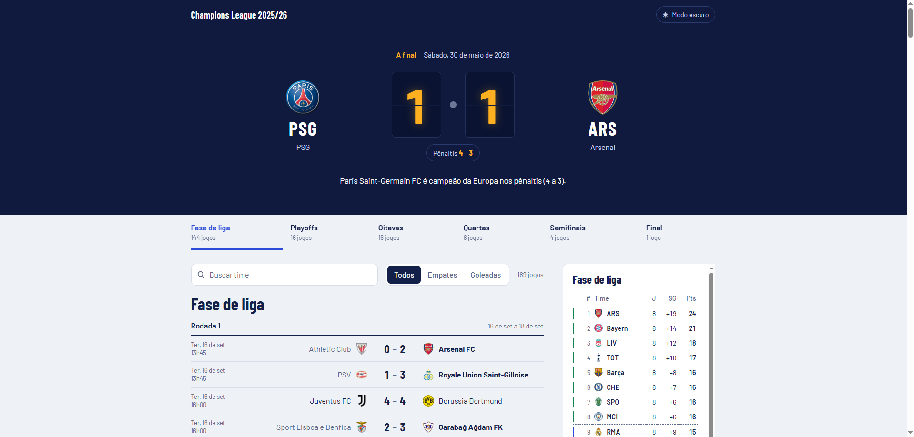
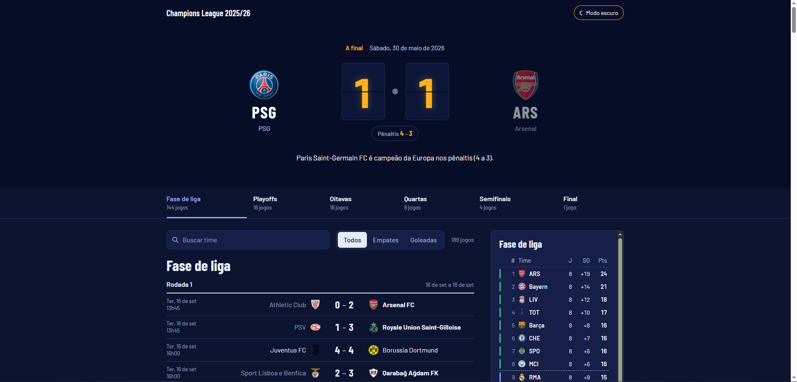

# Projeto Fullstack com FastAPI, React e Docker

Aplicação fullstack que exibe os **resultados da Champions League 2025/26**, da fase de liga à final. O backend em **FastAPI** consome a API externa **[football-data.org](https://www.football-data.org/)** e entrega os dados tratados ao frontend em **React**. O projeto foi construído com o objetivo de demonstrar a comunicação entre frontend e backend, a separação de responsabilidades entre as camadas da aplicação e a execução do ambiente por meio de **containers Docker**.

| Tema claro | Tema escuro |
|---|---|
|  |  |

---

## Visão Geral

A aplicação possui duas funcionalidades principais:

- **`/api01`**: retorna uma lista estática de usuários cadastrados no backend.
- **`/api02`**: consome a API externa **football-data** e retorna todas as partidas da Champions League 2025/26 com os dados tratados para exibição no frontend.

No frontend, os dados são exibidos em páginas separadas de acordo com a rota acessada. A página **`/api02`** é a tela principal de resultados.

---

## Funcionalidades

### Tela de resultados (`/api02`)

- **Placar da final em destaque**, em estilo de placar de estádio:
  - os números sobem de 0 até o placar final uma única vez, ao carregar a página;
  - quando o jogo foi decidido nos pênaltis, o placar mostra o resultado real (ex.: 1 x 1) e os pênaltis separados;
  - sem animação para quem ativou a preferência de reduzir movimento no sistema (`prefers-reduced-motion`).
- **Trilha de fases** fixa no topo (Fase de liga, Playoffs, Oitavas, Quartas, Semifinais e Final):
  - mostra a quantidade de jogos de cada fase;
  - clicar em uma fase leva até ela na página;
  - a fase visível na tela fica marcada enquanto a página é rolada.
- **Jogos em linhas compactas**, agrupados por fase e rodada (ida e volta no mata-mata):
  - data e horário no fuso de quem acessa;
  - vencedor em destaque;
  - placar dos pênaltis quando houver;
  - **agregado** nos jogos de volta do mata-mata, indicando quem avança.
- **Classificação da fase de liga**, calculada a partir dos jogos (pontos, saldo e gols marcados), com as zonas:
  - 1º ao 8º: direto às oitavas;
  - 9º ao 24º: playoffs;
  - 25º ao 36º: eliminados.
- **Busca por time** sem diferenciar acentos e maiúsculas (ex.: `munchen` encontra Bayern München), também pelo nome curto ou pela sigla.
- **Filtros** Todos, Empates e Goleadas (3 ou mais gols de diferença), com a contagem de jogos exibidos.
- **Campanha do time**: ao clicar em um time (no placar, na lista ou na classificação), aparece o resumo de vitórias, empates, derrotas e gols, além da sequência de resultados.
- **Tema claro e escuro**: segue o sistema por padrão, e o botão no topo alterna e salva a escolha.
- **Layout responsivo**: em telas menores, a classificação vai para baixo da lista e os jogos exibem as siglas dos times.
- **Acessibilidade**: navegação completa por teclado, foco visível e atalho "Pular para os jogos".
- **Tela de erro** com a mensagem do backend, dicas para conferir os containers e o botão "Tentar de novo".
- Escudos com reserva: se a imagem não carregar, aparecem as iniciais do time.

### Infraestrutura

- Execução da aplicação com **containers separados** para backend e frontend
- Comunicação entre os serviços por meio de uma **rede Docker compartilhada**

---

## Tecnologias Utilizadas

### Backend
- Python 3.12
- FastAPI
- Uvicorn
- Requests
- Pydantic
- Python-dotenv

### Frontend
- React 19 (Create React App / `react-scripts`)
- `fetch` com timeout na página `/api02`
- Axios na página `/api01`
- CSS

### Testes
- Jest (incluído no `react-scripts`)
- Testing Library (`@testing-library/react`, `jest-dom` e `user-event`)

### Containerização
- Docker

---

## Estrutura do Projeto

```bash
backend/
├── main.py              # rotas /api01 e /api02 e tratamento dos dados da football-data
├── requirements.txt
├── Dockerfile
├── .dockerignore
├── .env.example         # modelo do .env (copie para .env e coloque o seu token)
└── .env                 # não versionado

frontend/
├── public/
│   └── index.html
├── src/
│   ├── App.js           # escolhe a página pela rota (/api01 ou /api02)
│   ├── App.css          # estilos (os da tela de resultados ficam escopados em .champions)
│   ├── App.test.js      # testes da tela /api02 renderizada
│   ├── index.js
│   └── champions/
│       ├── Champions.js         # estado da tela, carregamento, filtros, rolagem e foco
│       ├── api.js               # fetch do /api02 com timeout, validação e mensagens de erro
│       ├── temporada.js         # regras de domínio em funções puras: fases, agregados, classificação, filtros, campanha
│       ├── temporada.test.js    # testes das regras de domínio
│       ├── formatar.js          # datas em pt-BR, iniciais dos times e preferência de movimento
│       ├── useTema.js           # tema claro/escuro salvo no navegador
│       └── componentes/
│           ├── Placar.js        # placar da final com a animação
│           ├── Trilha.js        # trilha de fases
│           ├── ListaJogos.js    # jogos agrupados por fase e rodada, com agregados
│           ├── Classificacao.js # tabela da fase de liga com as zonas
│           ├── Campanha.js      # campanha do time selecionado
│           ├── Escudo.js        # escudo com reserva de iniciais
│           └── Estados.js       # carregando, erro e nenhum resultado
├── package.json
├── package-lock.json
├── Dockerfile
├── .dockerignore
└── .gitignore
```

---

## Endpoints da Aplicação

### Backend

- **`GET /api01`**  
  Retorna uma lista estática de usuários cadastrados no backend.

- **`GET /api02`**  
  Consome a API externa **football-data** e retorna as partidas da Champions League 2025/26 com informações formatadas para o frontend.

### Campos de cada partida em `/api02`

| Campo | Descrição |
|---|---|
| `data` | Data e hora da partida em UTC (ISO 8601) |
| `fase` | Fase da competição, vinda do campo `stage` da API: `LEAGUE_STAGE`, `PLAYOFFS`, `LAST_16`, `QUARTER_FINALS`, `SEMI_FINALS`, `FINAL` |
| `rodada` | Rodada (`matchday`): de 1 a 8 na fase de liga, 1 (ida) e 2 (volta) no mata-mata, `null` na final |
| `mandante` / `visitante` | Nome completo dos times |
| `nome_curto_mandante` / `nome_curto_visitante` | Nome curto (`shortName`), ex.: "Bayern" |
| `sigla_mandante` / `sigla_visitante` | Sigla (`tla`), ex.: "PSG". Se a API não enviar a sigla, usa o nome curto |
| `escudo_mandante` / `escudo_visitante` | URL do escudo |
| `gols_mandante` / `gols_visitante` | Placar real da partida (tempo normal + prorrogação), **sem** os pênaltis |
| `penaltis_mandante` / `penaltis_visitante` | Placar da disputa de pênaltis, ou `null` se não houve |
| `status` | `"Encerrado"` para jogos finalizados, ou o status original da API |
| `vencedor` | Nome do time vencedor (considerando prorrogação e pênaltis), `"Empate"` ou `"Jogo não finalizado"` |

Exemplo (a final):

```json
{
  "data": "2026-05-30T16:00:00Z",
  "fase": "FINAL",
  "rodada": null,
  "mandante": "Paris Saint-Germain FC",
  "visitante": "Arsenal FC",
  "nome_curto_mandante": "PSG",
  "nome_curto_visitante": "Arsenal",
  "sigla_mandante": "PSG",
  "sigla_visitante": "ARS",
  "escudo_mandante": "https://crests.football-data.org/524.png",
  "escudo_visitante": "https://crests.football-data.org/57.png",
  "gols_mandante": 1,
  "gols_visitante": 1,
  "penaltis_mandante": 4,
  "penaltis_visitante": 3,
  "status": "Encerrado",
  "vencedor": "Paris Saint-Germain FC"
}
```

### Erros do `/api02`

Quando a API externa falha, o backend responde com um status HTTP e uma mensagem no formato `{"detail": "..."}`, que o frontend exibe na tela de erro:

| Status | Quando acontece |
|---|---|
| `500` | A variável `Futebol_API_Token` não está configurada no container |
| `502` | A football-data recusou o token (401/403), respondeu com outro erro ou não foi possível conectar a ela |
| `503` | O limite de requisições da football-data foi atingido (tente de novo em um minuto) |
| `504` | A football-data não respondeu em 10 segundos |

---

## Integração com API Externa

A rota **`/api02`** depende de um token da API **football-data**.

### Como obter o token

1. Acesse o site **[football-data.org](https://www.football-data.org/)**  
2. Crie uma conta na plataforma  
3. Gere ou copie o token disponibilizado  
4. Utilize esse token na execução do projeto  

---

## Variáveis de Ambiente

O backend lê o token da variável de ambiente `Futebol_API_Token`. Ele nunca fica fixo no código.

O token fica no arquivo `backend/.env`, que está no `.gitignore` e por isso não é versionado. O repositório traz o modelo `backend/.env.example`:

```env
Futebol_API_Token=seu_token_aqui
```

Escreva a linha **sem espaços ao redor do `=` e sem aspas**. O Docker lê o arquivo com `--env-file` de forma literal: espaços ou aspas passariam a fazer parte do nome ou do valor da variável.

Na execução com Docker, o arquivo é entregue ao container com `--env-file backend/.env`.

---

## Comunicação entre os Containers

Como o frontend e o backend são executados em containers separados, a comunicação entre eles dentro da rede Docker não acontece por `localhost`, mas sim pelo **nome do container do backend**.

Neste projeto, o container do backend foi nomeado como **`backend`**. Por isso, o frontend utiliza esse mesmo nome no proxy do `package.json`:

```json
"proxy": "http://backend:8000"
```

O navegador acessa apenas `localhost:3000`. As requisições do frontend usam URLs relativas (`/api01` e `/api02`), e o servidor de desenvolvimento do React as repassa para o container `backend` dentro da rede Docker compartilhada.

---

## Pré-requisitos

Antes de executar o projeto, é necessário ter as seguintes ferramentas instaladas na máquina:

- [Git](https://git-scm.com/) para clonar o repositório
- [Docker](https://www.docker.com/products/docker-desktop/) para criar e executar os containers da aplicação

Além disso, para que a rota **`/api02`** funcione corretamente, é necessário possuir uma conta e um **token de API** válido gerado na plataforma [football-data.org](https://www.football-data.org/).

---

## Como Executar o Projeto

Todos os comandos abaixo são executados **a partir da pasta raiz do projeto**.

### 1. Criar o arquivo `.env` com o token

Copie o modelo e substitua `seu_token_aqui` pelo token obtido na plataforma **football-data**, no formato `Futebol_API_Token=valor`, sem espaços e sem aspas.

```bash
cp backend/.env.example backend/.env
```

### 2. Criar a rede Docker

Crie uma rede Docker para permitir a comunicação entre os containers do frontend e do backend.

```bash
docker network create fullstack
```

### 3. Criar as imagens Docker

O último argumento de cada comando indica a pasta que contém o `Dockerfile`.

```bash
docker build -t backend_atividade ./backend
docker build -t frontend_atividade ./frontend
```

### 4. Rodar o container do backend

Esse comando cria e executa o container do backend com o nome **`backend`**, que será utilizado pelo frontend para se comunicar com a API dentro da rede Docker. O token é lido do arquivo `.env` e nunca aparece escrito no comando.

```bash
docker run -d --name backend --network fullstack -p 8000:8000 --env-file backend/.env backend_atividade
```

### 5. Rodar o container do frontend

Esse comando cria e executa o container do frontend, conectando-o à mesma rede do backend.

```bash
docker run -d --name frontend --network fullstack -p 3000:3000 frontend_atividade
```

O servidor do React leva alguns segundos para compilar. Para acompanhar, use `docker logs -f frontend` e aguarde a mensagem `Compiled successfully!`.

---

## Como Acessar a Aplicação

### Frontend
- **http://localhost:3000/api01**
- **http://localhost:3000/api02** (tela de resultados)

### Backend
- **http://localhost:8000/api01**
- **http://localhost:8000/api02**
- **http://localhost:8000/docs** (documentação interativa gerada pelo FastAPI)

---

## Como Atualizar Depois de Mudar o Código

Os Dockerfiles copiam o código para dentro da imagem no momento do build. Por isso, depois de alterar o código, é preciso **recriar a imagem e o container**. Um `docker restart` não basta, porque continua usando a imagem antiga. Só é preciso refazer o lado que mudou.

Backend:

```bash
docker build -t backend_atividade ./backend
docker rm -f backend
docker run -d --name backend --network fullstack -p 8000:8000 --env-file backend/.env backend_atividade
```

Frontend:

```bash
docker build -t frontend_atividade ./frontend
docker rm -f frontend
docker run -d --name frontend --network fullstack -p 3000:3000 frontend_atividade
```

Para trocar apenas o token, não é preciso refazer o build: edite o `backend/.env` e recrie o container do backend (`docker rm -f backend` e o `docker run` acima).

---

## Problemas Comuns

| Sintoma | Causa | Solução |
|---|---|---|
| `Conflict. The container name "/backend" is already in use` | Já existe um container com esse nome | `docker rm -f backend` (ou `frontend`) e rode o `docker run` de novo |
| `Bind for 0.0.0.0:8000 failed: port is already allocated` | Outro processo ou container está usando a porta | Pare o que usa a porta ou mude só o lado da máquina, ex.: `-p 8001:8000` |
| `network with name fullstack already exists` | A rede já foi criada antes | Nada a fazer: a rede existente é reutilizada |
| `/api02` responde `502` com "A football-data recusou o token" | Token inválido, ou o `.env` tem espaços ou aspas | Corrija o `backend/.env` (`Futebol_API_Token=valor`) e recrie o container do backend |
| `/api02` responde `500` com "Token da football-data não configurado" | O container foi criado sem o `--env-file` | Recrie o container do backend com `--env-file backend/.env` |
| A tela mostra "Não foi possível conectar ao backend" | O container `backend` está parado ou fora da rede `fullstack` | Confira com `docker ps` e `docker logs backend` |

---

## Testes

Os testes do frontend usam **Jest** e **Testing Library**. Com os containers rodando, eles podem ser executados dentro do container do frontend, sem precisar instalar o Node.js na máquina:

```bash
docker exec -e CI=true frontend npm test -- --watchAll=false
```

`CI=true` e `--watchAll=false` fazem os testes rodarem uma vez e encerrarem. Sem eles, o Jest fica em modo de observação. Como o código é copiado no build, depois de mudar um teste é preciso recriar a imagem do frontend.

O que os testes cobrem:

- **`src/champions/temporada.test.js`**: regras de domínio, ou seja, agrupamento por fase e rodada, trilha com todas as fases, agregados (inclusive empate decidido nos pênaltis), classificação e zonas, siglas repetidas, busca sem acento, filtros e campanha do time.
- **`src/App.test.js`**: a tela `/api02` renderizada, com placar da final e pênaltis, trilha, busca, filtros, campanha, tela de erro com "Tentar de novo" e a garantia de que um texto vindo da API é exibido como texto, nunca interpretado como HTML.

---

## Arquitetura da Aplicação

### Backend
Responsável por:

- disponibilizar as rotas da aplicação
- retornar dados locais na rota **`/api01`**
- consumir a API externa de futebol na rota **`/api02`**, com tempo limite e erros claros
- tratar e organizar os dados antes de enviá-los ao frontend

### Frontend
Responsável por:

- consumir as rotas do backend
- exibir os dados em páginas separadas
- montar a temporada a partir dos jogos (fases, agregados e classificação) e apresentar visualmente as informações das partidas

### Docker
A aplicação utiliza:

- **1 container para o backend**
- **1 container para o frontend**
- **1 rede Docker compartilhada** para permitir a comunicação entre os serviços

---

## Decisões Técnicas

- **Placar real e pênaltis separados.** O campo `fullTime` da football-data soma os gols da disputa de pênaltis: a final 1 x 1 (4 x 3 nos pênaltis) chegaria como 5 x 4. O backend desconta os pênaltis, expõe o placar real em `gols_*` e os pênaltis em `penaltis_*`. O vencedor vem de `score.winner`, que já considera prorrogação e pênaltis.
- **Fases vindas da API.** As fases e rodadas vêm dos campos `stage` e `matchday` da football-data, e não de uma dedução pelas datas dos jogos.
- **Sigla não identifica o time.** Bayern e Barcelona têm a mesma sigla, "FCB". Por isso, os times são identificados pelo nome completo, e siglas repetidas são exibidas como o nome curto ("Bayern", "Barça").
- **Lógica de domínio em funções puras.** As regras da temporada ficam em `temporada.js`, sem depender de React nem do navegador, o que permite testá-las de forma isolada.
- **Segurança e resiliência no frontend.** Os dados da API são renderizados apenas como texto pelo JSX, sem `innerHTML`, o que evita XSS. A requisição ao backend usa `fetch` com tempo limite e mostra uma tela de erro útil em vez de ficar carregando para sempre.

---

## Observações

- O backend precisa estar em execução para que o frontend consiga consumir as rotas corretamente.
- A rota **`/api02`** depende de conexão com a internet e de um token válido da API externa.
- O plano gratuito da football-data tem limite de requisições por minuto, e cada carregamento da página `/api02` faz uma requisição.
- O container do frontend executa o servidor de desenvolvimento do React (`npm start`), adequado para estudo e não para produção.
- A classificação usa pontos, saldo de gols e gols marcados. O regulamento da UEFA tem critérios de desempate adicionais que a API não fornece.
- O projeto foi desenvolvido com foco em aprendizado de integração entre frontend e backend, consumo de API externa e containerização com Docker.
